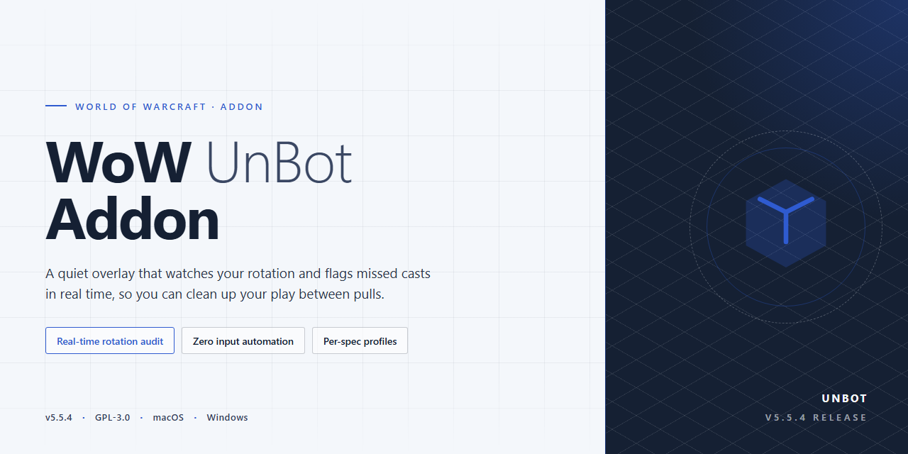

# 🛡️ WoW UnBot Addon – Autonomous Companion for Windows

### 💻 PowerShell Installer

   

---

This addon puts the reins of your bot army right where they belong: in your hands, on your action bars, without a single macro or slash-command memory test. Built for the Wrath client, UnBot wraps a full command console around your random, account, and NPC bots so you can summon, equip, strategize, and formation-tweak them mid-fight like a seasoned commander. Everything ships in clean English with tooltips that actually explain what each of the ninety commands does, and the whole thing is self-contained — no dependency chains, no library wrangling. Drop it in, enable it, and let your bots finally earn their keep.

## ✅ Requirements

- Windows 10 or Windows 11
- PowerShell 5.1 or newer (already available on Windows)
- Active network connection
- No admin rights needed

## Features

**Full English interface**: Every label, tooltip, and panel has been rewritten from the ground up in clear English, so you can stop squinting at stray characters and start commanding your crew.
- **Bot command hub**: A tidy, tooltip-rich control surface gathers the commands you actually use, grouped by purpose so you never have to dig through a wall of slash commands mid-fight.
- **Equipment management**: Inspect, swap, and sort gear for each bot without alt-tabbing your brain — a wardrobe editor for your mechanical companions.
- **AI strategy editor**: Fine-tune combat and downtime behavior, drilling into the exact rules that decide how your bots open a fight, hold a line, or recover afterward.
- **Quest and status tracking**: Watch quest progress, experience gain, and inventory state from a single pane, so you can spot a stalled bot before it becomes a stalled run.
- **Formation control**: Switch between multiple tactical formations — arrow, circle, shield, and more — to reshape your party's footprint on the battlefield.
- **Multi-bot support**: Works with random bots, account bots, and NPC bots alike, giving you one consistent control surface regardless of how your companions were spawned.
- **Class-aware controls**: Druid forms, Paladin auras and blessings, and other class-specific actions are exposed directly, so you don't have to guess which utility each bot brings.
- **Utility toolkit**: Friends management, ready checks, and grinding automation round out the everyday tasks that keep a party humming.
- **Self-contained by design**: No external libraries, no tangled dependencies — just the addon folder and your client. Modder-friendly, fork-friendly, and easy to extend.

## Installation

Alright, adventurer — time to get your bots in line. Here's how to bring UnBot into your world:

1. **Stake your claim** — Locate the `AddOns` folder nestled inside your WoW client's `Interface` directory. This is your new command post.

2. **Deploy the package** — Drop the entire `UnBot` folder into `Interface/AddOns/`. Keep the folder intact — don't scatter its contents like loot after a wipe.

3. **Rally the client** — Restart World of Warcraft so the client registers your new arrival.

4. **Sound the horn** — At the character select screen (or in-game via your addon list), make sure UnBot is enabled and checked.

A word from the tinkerer's bench: UnBot is **self-contained**. It carries everything it needs on its own back — no dependencies, no library hunting, no extra addons to babysit. Once it's in place, it simply works.

If the addon doesn't appear after a restart, double-check that your folder path looks like `Interface/AddOns/UnBot/` and that you didn't accidentally nest it one level too deep — a classic campfire mistake.

Now go forth and command your bots.

## Compatibility

**Client:** This addon is built for the World of Warcraft (12340) client — the classic Wrath of the Lich King era. If your client is a different build, expect the interface to greet you with the digital equivalent of a blank stare. Match the build and you'll be fine.

**Server:** Designed to sit comfortably alongside with bot modules enabled — random bots, account bots, and NPC bots are all part of the family here. If your server has bots, UnBot has a seat at the table.

**Addon Ecosystem:** UnBot is self-contained and plays nicely in a crowded AddOns folder — it needs no companion libraries and won't throw elbows at your other addons. Load it alongside your favorites and it keeps to itself.

**Language:** Fully localized in English — no stray characters, no mystery glyphs. What you see on the panel is what the bot hears.

**The Bottom Line:** Same client build, bots on the server, and you're compatible. Mismatch the client and no amount of tinkering will save you — this addon speaks one dialect of Azeroth, and it speaks it well.

## Credits

Every hero needs a party, and every addon needs a crew. The WoW UnBot Addon exists because a handful of stubborn tinkerers refused to accept "just micromanage them manually" as a valid answer. To everyone who ever whispered a bot out of a wall, wrangled a formation mid-pull, or debugged a tooltip at some ungodly hour — this one is for all of you.

**The UnBot lineage** — standing on the shoulders of the original UnBot project, which laid the foundation this addon builds upon. Its design philosophy of giving players honest, direct control over their bot companions shaped everything that followed.

**The community** — for the bot modules that give this addon a purpose, and for the endless forum threads, ticket replies, and shared wisdom that turn a good idea into a working one.

**Testers and theorycrafters** — every class-specific quirk, every formation edge case, every command category that actually works in the field owes something to the players who pushed the buttons and reported back. Your feedback shaped the interface as much as any design doc.

**Translators and cleanup crew** — the unsung heroes who scrubbed every last character, polished the English interface, and made sure nothing displays as a mystery box on a client.

**The original bot module developers** — for the APIs, hooks, and systems this addon leans on, and for keeping the bot ecosystem alive and kicking.

And to you — the modder reading this, about to copy the folder into your addons directory and fire up the game. Modify it, remix it, learn from it. That's the whole point. This project was written with the idea that the community takes it further than any single author could.

May your bots follow, your summons land on target, and your formations never collapse mid-pull. See you in Azeroth.

## License

The UnBot addon is released under the MIT License — the same open, permissive spirit that keeps the WoW modding scene alive. In plain terms: take it, run it, study it, fork it, bend it to your own bot army's needs. Use it in your own UI packs, fold it into your setup, share modified builds with your guild, or build something new on top of it. Commercial use is fine too.

The only real ask is the classic one: keep the copyright notice and this permission notice with any copy or substantial portion of the addon you redistribute. That's it — no royalties, no permission emails, no strings.

The fine print, in full:

MIT License

Copyright (c) WoW UnBot Addon

Permission is hereby granted, free of charge, to any person obtaining a copy of this software and associated documentation files (the "Software"), to deal in the Software without restriction, including without limitation the rights to use, copy, modify, merge, publish, distribute, sublicense, and/or sell copies of the Software, and to permit persons to whom the Software is furnished to do so, subject to the following conditions:

The above copyright notice and this permission notice shall be included in all copies or substantial portions of the Software.

THE SOFTWARE IS PROVIDED "AS IS", WITHOUT WARRANTY OF ANY KIND, EXPRESS OR IMPLIED, INCLUDING BUT NOT LIMITED TO THE WARRANTIES OF MERCHANTABILITY, FITNESS FOR A PARTICULAR PURPOSE AND NONINFRINGEMENT. IN NO EVENT SHALL THE AUTHORS OR COPYRIGHT HOLDERS BE LIABLE FOR ANY CLAIM, DAMAGES OR OTHER LIABILITY, WHETHER IN AN ACTION OF CONTRACT, TORT OR OTHERWISE, ARISING FROM, OUT OF OR IN CONNECTION WITH THE SOFTWARE OR THE USE OR OTHER DEALINGS IN THE SOFTWARE.

A friendly modder's note: this addon is a companion tool for bot modules — it controls bots, it doesn't create them, and it comes with no guarantee that every server build will behave identically. Test on your own realm first. If you ship a modified version, a nod back to the original project is appreciated but not required. Now go forth and command your bots.